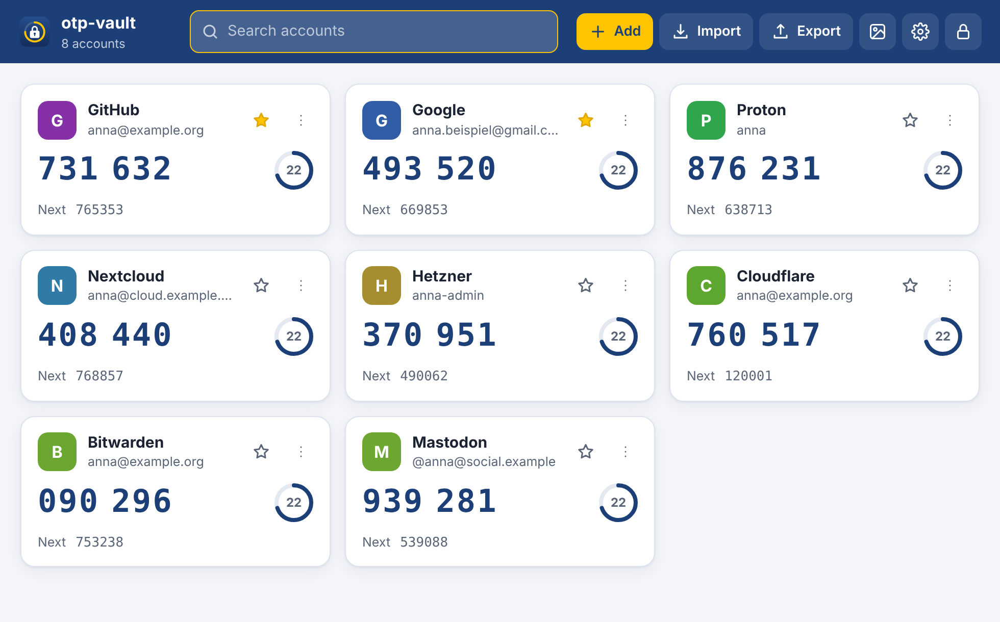
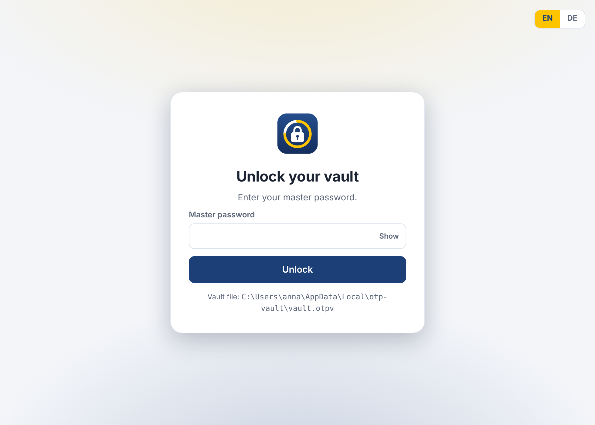
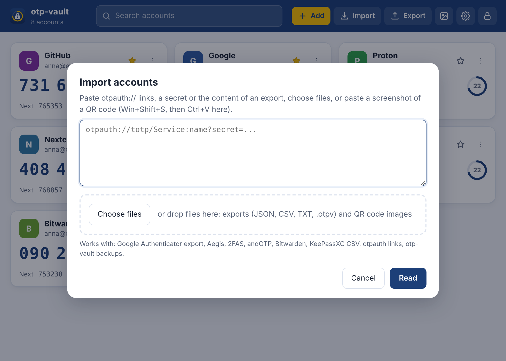
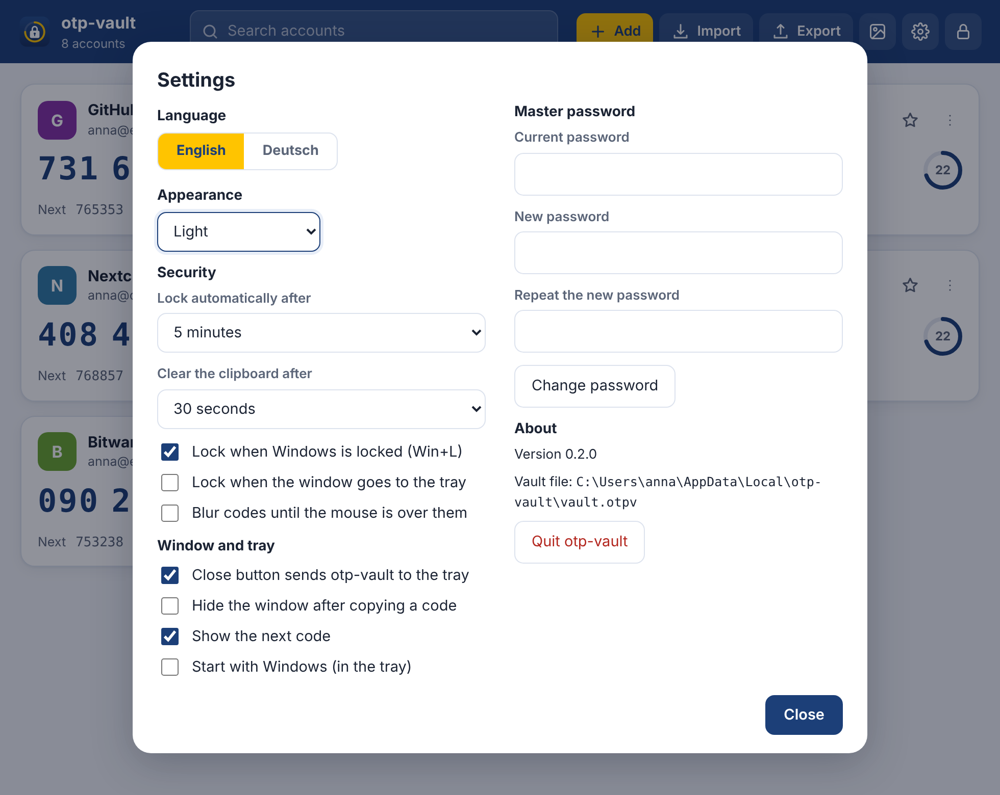
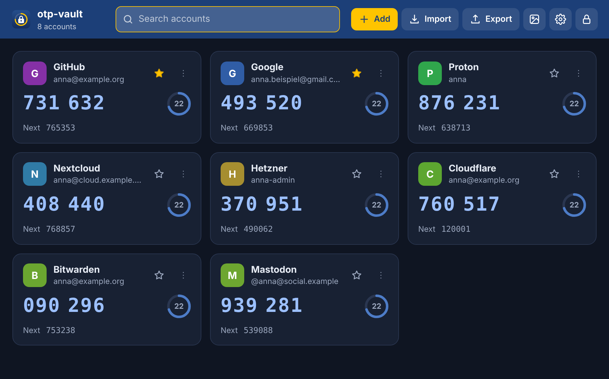

<div align="center">


# otp-vault

### Your two-factor codes on Windows, encrypted

**A window and a tray icon for all your TOTP codes: click a code and it is copied.** Import from nearly every authenticator app, export in every direction, and print A4 recovery sheets with QR codes. One EXE, nothing to install.

[](#-requirements)
[](#-building-it-yourself)
[](#-building-it-yourself)
[](#-license)
[](https://ko-fi.com/burnersen)

**[⬇️ Download the latest release](https://github.com/burnersen/otp-vault/releases/latest)** · **[🌐 Website](https://tech.burnersen.de/en/tools/otp-vault-en/)** · **[☕ Buy me a coffee](https://ko-fi.com/burnersen)**

<sub>🇩🇪 Auf Deutsch: [tech.burnersen.de/tools/otp-vault](https://tech.burnersen.de/tools/otp-vault/)</sub>



<sub>The window contents with made-up sample accounts.</sub>

</div>

> 💜 **Using otp-vault and happy with it?** A ⭐ on GitHub is the easiest way to let me know,
> and it does more than you'd think: stars are the visible proof that a project does good work,
> and they are how small projects like this one get found by other people in the first place. Or
> [tell me what you use it for](https://github.com/burnersen/otp-vault/issues/new), I read every message.
> Thanks for being here!

---

> ⚠️ **Before you start:** otp-vault is free hobby software without any warranty, and you use it at your own risk. Keep an independent backup of your two-factor secrets and the recovery codes of your accounts: a lost master password cannot be recovered. Details in the disclaimer at the end.

## ⚡ 30 seconds, no manual

1. Download `otp-vault.exe` from the latest release and start it.
2. Choose a master password. It encrypts everything.
3. **Add** an account (paste the secret or the `otpauth://` link) or **Import** the export of your old app. Click a code to copy it.

## ✨ What it does

- **All codes at a glance**: big, readable codes with a countdown ring and the next code below. TOTP, HOTP and Steam; SHA1, SHA256, SHA512; 6, 7 or 8 digits; any period.
- **Click to copy**: the clipboard is cleared again after 30 seconds, and Windows keeps the code out of the clipboard history (Win+V) and the cloud clipboard. The same goes for a secret or link copied from the details, and the clipboard is cleared when you quit.
- **Import from almost anything**: a bare secret, `otpauth://` links (with or without issuer; missing names are asked for), Google Authenticator export QR codes, Aegis (plain and encrypted), 2FAS (plain and encrypted), andOTP, Bitwarden JSON and CSV, KeePassXC CSV, any CSV with a secret column, otp-vault backups. QR codes from image files or a pasted screenshot (Win+Shift+S, then Ctrl+V). Duplicates are recognised.
- **Export in every direction**: encrypted backup (with the master password or its own), A4 recovery sheet (PDF) with QR code, service, user name and secret, QR codes for Google Authenticator, Aegis JSON, `otpauth://` links, CSV. Plain exports warn first.
- **Icons**: on request, fetched from the service's own website and stored inside the vault. Or choose your own image.
- **Tray**: the close button sends it to the tray; left click shows or hides the window, right click to lock or quit. Optional start with Windows. If it ever goes down (for example when the Windows web view crashes), it starts again by itself in the tray. The window opens in the size you left it.
- **German and English**, light and dark like Windows.

## 🖼️ A look around

| Unlock | Import | Settings |
|---|---|---|
|  |  |  |

Light and dark follow Windows:



---

## 🔒 Security

- The vault is one file, encrypted with **XChaCha20-Poly1305**; the key comes from your master password with **Argon2id** (64 MiB, 3 passes). Without the password nothing is readable, not even the names of the accounts.
- **Auto lock** after 5 minutes without use (adjustable), when Windows is locked (Win+L), and optionally when the window goes to the tray.
- Every change is saved at once; the previous file is kept as `vault.otpv.bak`. That is a safety net, not a backup: keep an encrypted export somewhere else too. After a password change the backup is replaced too, so no file opens with the old password any more.
- **No network**, except when you click "Fetch icons": then only the host name of the service is contacted, never a secret or a user name. No icon service in between.

## 📁 Where its files live

| What | Where |
|---|---|
| Vault | `%LOCALAPPDATA%\otp-vault\vault.otpv` (and `vault.otpv.bak`) |
| Settings | `%LOCALAPPDATA%\otp-vault\settings.json` |
| Window size | `%LOCALAPPDATA%\otp-vault\window.json` |
| Log | `%LOCALAPPDATA%\otp-vault\logs\otp-vault.log` (and `crash.log` if it ever crashed) |

**Portable:** put an empty file `portable.txt` next to the exe, and everything stays in that folder (vault in `data\`). The log never grows past 2 MB and contains no secrets.

**Keyboard:** Ctrl+F search, Enter copies the first match, Ctrl+N add, Ctrl+L lock, Esc closes.

## 💻 Requirements

Windows 10 or 11 (x64 or ARM64). The window uses the Microsoft Edge WebView2 runtime, which is part of current Windows.

**Windows SmartScreen** may warn because the files are not digitally signed yet. Choose "More info", then "Run anyway". Every release is built by GitHub Actions from this repository, and `SHA256SUMS.txt` lists the checksum of every file.

## 🔧 Building it yourself

Go in the version from `go.mod` and the Wails CLI (`go install github.com/wailsapp/wails/v2/cmd/wails@v2.17.1`):

```
go test ./...
node frontend/app_check.js
wails build -platform windows/amd64 -skipbindings -trimpath
```

## ☕ Support

otp-vault is free and made in my spare time, on my own hardware and electricity bill. If it saved you time and you'd like to say thanks, you can [drop a little something in the tip jar on Ko-fi](https://ko-fi.com/burnersen), it keeps motivation and coffee flowing. ☕ Completely optional, and either way: thank you for using it!

## ⚠️ Disclaimer

otp-vault is free hobby software, provided **"as is", without any warranty or condition of any kind**. It was built and tested with care, but you use it **at your own risk**. Keep an independent backup of your two-factor secrets (an encrypted export or the printed recovery sheet) and the recovery codes of your accounts: a lost master password cannot be recovered by anyone.

Where this README describes what otp-vault does, checks or never does, that is how it is designed to work, not a promise or guarantee: software can have bugs, and systems, services and other programs do not always behave as expected. As far as the applicable law allows, the author is not liable for any damages or data loss arising from the use of this software. See sections 15 and 16 of the [license](LICENSE).

---

---

## 📜 License

GPL-3.0-only, see [LICENSE](LICENSE). Included: the QR encoder of [rsc.io/qr](https://github.com/rsc/qr) (BSD-3-Clause, `internal/qr/LICENSE`) and [jsQR](https://github.com/cozmo/jsQR) 1.4.0 for reading QR codes (Apache-2.0, `frontend/dist/vendor/jsQR.LICENSE.txt`).
